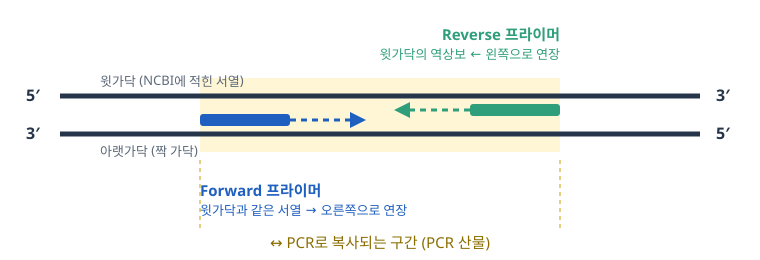

# 10주차 · qPCR 프라이머 한 쌍 설계하기

> **오늘의 목표**: 내가 배정받은 사람 유전자의 발현량을 qPCR로 재기 위한 **프라이머 한 쌍**(앰플리콘 70–150 bp)을 만들고, 그 프라이머가 **어느 가닥 어디에 붙는지**, **어떤 조건으로 돌려야 하는지**까지 스스로 확인한다.

| 순서 | 내용 | 시간 |
|---|---|---|
| Part&nbsp;1 | 이론: 프라이머, 역상보, Tm, 2차 구조 | 30–40분 |
| Part&nbsp;2 | 실습: 프라이머 직접 설계부터 비교평가까지 | 70–80분 |

실습 흐름: 핀볼 → mRNA·gDNA 맞대기 → 프라이머 직접 설계(역상보, Tm) → 점검 → PCR 시뮬레이션 → 비교평가(컴퓨터가 설계한 쌍과 비교)

**준비물**: 노트북, 인터넷. 가입하거나 설치할 것은 없습니다.

**제출물**: [기록지](worksheet.md)의 필수 항목을 갖춘 보고서를 사이버캠퍼스에 제출

**웹 도구**: https://jw-huh.github.io/primer-design-lab/

---

## Part 1. 이론

### 1-1. PCR이 하는 일

PCR (Polymerase Chain Reaction, 중합효소 연쇄반응)은 긴 DNA 중에서 **내가 원하는 구간만 골라 수백만 배로 복사**하는 방법입니다. 한 번 복사할 때마다 양이 두 배가 되므로, 30번 반복하면 이론상 약 10억 배가 됩니다.

| 재료 | 하는 일 |
|---|---|
| 주형 DNA (template) | 복사할 원본. 오늘은 mRNA를 역전사한 **cDNA** |
| 프라이머 2개 | 복사를 **어디서 시작할지** 알려 줌 |
| DNA 중합효소(polymerase) | 새 DNA 가닥을 만드는 효소 |
| dNTP (A, T, G, C) | 새 가닥의 재료 |
| 버퍼, Mg²⁺ | 효소가 일할 수 있는 환경 |

### 1-2. 한 사이클은 세 단계

| 단계 | 온도 | 일어나는 일 |
|---|---|---|
| ① 변성(denaturation) | 95 °C | 두 가닥 DNA가 열 때문에 한 가닥씩 떨어진다 |
| ② 결합(annealing) | 55–65 °C | 프라이머가 자기와 짝이 맞는 자리에 붙는다 |
| ③ 연장(extension) | 72 °C | 중합효소가 프라이머 끝에서부터 새 가닥을 이어 만든다 |

**②에서 프라이머가 정확한 자리에만 붙어야** 원하는 구간만 복사됩니다. 결합 온도가 너무 낮으면 비슷한 엉뚱한 자리에도 붙고, 너무 높으면 제자리에도 못 붙습니다.

### 1-3. qPCR 프라이머는 무엇이 다른가(복습)

| | 일반 PCR | qPCR |
|---|---|---|
| 앰플리콘(산물) 길이 | 수백 bp – 수 kb | **70–150 bp** |
| 사이클 | 변성 95 °C / 결합 55–65 °C / 연장 72 °C | 변성 95 °C 15초 / **결합 60 °C 1분**(산물이 짧아 연장을 따로 두지 않기도 함) |
| 프라이머 Tm | 효소에 맞춰 | **60 °C 근처** |

짧은 앰플리콘은 매 사이클 끝까지 복제되어 효율이 일정합니다. 다만 70 bp보다 짧으면 프라이머 이합체와 구분하기 어렵습니다.

> **SYBR Green 다시 보기**
> - 이중가닥 DNA 사이에 끼어들면 강하게 빛나는 형광 염료입니다. 산물이 늘수록 형광도 커집니다.
> - 형광이 기준선을 넘는 사이클이 **Ct**입니다. 처음 주형이 많을수록 Ct가 작습니다.
> - 이중가닥이면 무엇에든 빛나므로 프라이머 이합체나 비특이 산물도 신호에 섞입니다.
> - 그래서 반응 끝에 온도를 천천히 올리며 형광이 떨어지는 온도를 봅니다(**Tm 곡선**, melt curve). 봉우리가 하나면 산물이 한 종류입니다.

### 1-4. 5′과 3′, 그리고 프라이머가 두 개인 이유

DNA 가닥에는 방향이 있습니다. 한쪽 끝을 **5′ (5 프라임)**, 반대쪽 끝을 **3′ (3 프라임)** 이라고 부르고, 두 가닥은 서로 **반대 방향**으로 짝을 이룹니다.

DNA 중합효소의 규칙은 두 가지입니다.

1. 새 가닥은 **5′ → 3′ 방향으로만** 늘어난다.
2. 아무것도 없는 곳에서는 시작하지 못하고, **이미 붙어 있는 짧은 가닥(프라이머)의 3′ 끝**에 이어 붙인다.

그래서 복사할 구간의 **왼쪽 끝**과 **오른쪽 끝**에 각각 하나씩, 서로 마주 보는 프라이머가 필요합니다.



- **Forward 프라이머**: 구간 왼쪽 끝의 윗가닥 서열을 **그대로** 쓴다. 아랫가닥에 붙어 오른쪽으로 연장된다.
- **Reverse 프라이머**: 구간 오른쪽 끝의 윗가닥 서열을 **역상보**로 바꿔 쓴다. 윗가닥에 붙어 왼쪽으로 연장된다.

> 프라이머 서열은 **항상 5′ → 3′ 방향으로** 적습니다.

### 1-5. 역상보(reverse complement)

**짝을 바꾸고(상보) + 순서를 뒤집어야(역순)** 합니다. 둘 중 하나만 하면 틀립니다.

| | 서열 | 설명 |
|---|---|---|
| 원래 서열 | 5′-**ATGCC**-3′ | |
| 상보 | 3′-TACGG-5′ | A↔T, G↔C만 바꿈. 방향이 3′→5′라서 이대로 쓰면 틀림 |
| 역순 | 3′-CCGTA-5′ | 순서만 뒤집음. 틀림 |
| **역상보** | 5′-**GGCAT**-3′ | 짝을 바꾸고 순서도 뒤집음. **정답** |

### 1-6. Tm과 세 가지 계산법

**Tm (melting temperature)** 은 프라이머의 절반이 주형에서 떨어지는 온도입니다. 계산법에 따라 같은 프라이머도 값이 다르게 나옵니다.

| 계산법 | 식 | 특징 |
|---|---|---|
| ① Wallace rule | Tm = 2 × (A+T) + 4 × (G+C) | 가장 간단. 14 nt 이하에서만 대략 맞고, 길어질수록 과대평가 |
| ② 기본 GC 함량 식(Marmur–Doty 계열) | Tm = 64.9 + 41 × (G+C − 16.4) / N | 길이로 나누는 항이 있어 긴 서열에서 Tm이 포화되는 경향을 반영. 13 nt 이상에서 사용 |
| ③ Nearest-neighbor (현재 표준) | Tm = ΔH / (ΔS + R ln(C/4)) − 273.15 + 염 보정 | 이웃한 두 염기쌍씩의 ΔH, ΔS를 더함. 같은 GC 비율이라도 **순서**에 따라 Tm이 달라지는 것까지 반영 |

③에서 ΔH (엔탈피)는 붙으려는 힘(수소결합, 염기 쌓임), ΔS (엔트로피)는 흩어지려는 경향, C는 프라이머 농도, R은 기체상수입니다. Na⁺, Mg²⁺ 같은 양이온은 인산 골격의 음전하를 가려 이중가닥을 안정시키므로 버퍼 조성에 따라 Tm이 바뀝니다.

### 1-7. 좋은 qPCR 프라이머의 조건

| 항목 | 기준 | 이유 |
|---|---|---|
| 앰플리콘 | **70–150 bp** | 1-3 참고 |
| 길이 | 18–25 nt | 짧으면 엉뚱한 곳에도 붙고, 길면 잘 떨어지지 않는다 |
| GC 비율 | 40–60% | G-C는 수소결합 3개, A-T는 2개. GC가 많을수록 단단히 붙는다 |
| Tm | 58–62 °C | 결합 온도 60 °C에 맞추기 위해 |
| 두 프라이머의 Tm 차이 | 3 °C 이내 | 한 온도에서 둘 다 잘 붙어야 한다 |
| 3′ 끝 | 마지막 5개 중 G/C 1–3개 | 너무 약하면 연장이 안 되고, 너무 강하면 엉뚱한 곳에서도 연장된다 |
| 반복 서열 | AAAA, ATATATAT 같은 반복 피하기 | 프라이머가 미끄러지며 엉뚱하게 붙는다 |
| 2차 구조 | 머리핀, 이합체 피하기 | 1-8. SYBR은 이합체에도 빛나서 qPCR에서 특히 중요 |
| 특이성 | 원하는 유전자에만 붙을 것 | 다른 유전자에도 붙으면 원하지 않는 산물이 생긴다 |

### 1-8. 프라이머의 2차 구조

**머리핀(hairpin)**: 한 가닥이 스스로 접힘

```
5'-GGATC--+
   |||||  )  loop
3'-CCTAG--+
```

**자기 이합체(self-dimer)**: 같은 프라이머 두 개가 서로 붙음

```
5'-ACGAATTCTG-3'
     ||||||
3'-GTCTTAAGCA-5'
```

**3′ 끝 이합체(3′-dimer)**: 3′ 끝끼리 붙음. 가장 나쁨

```
5'-GATTCCAACGT-3'
          ||||
       3'-TGCAACCTTAG-5'
```

- 접히거나 서로 붙은 프라이머는 주형에 가지 못합니다.
- 3′ 끝끼리 붙으면 중합효소가 그 자리에서 연장해 버려 짧은 **primer-dimer**가 생깁니다. qPCR에서는 SYBR이 여기에도 빛나서 Ct와 Tm 곡선을 망칩니다.
- **제한효소 자리**: GAATTC (EcoRI)처럼 대부분의 인식 서열은 역상보가 자기 자신과 같은 **회문(palindrome)** 입니다. 프라이머 안에 있으면 같은 프라이머끼리 그 6 bp가 그대로 짝을 이룹니다. 6 bp 하나로 실패하는 경우는 드물지만, 피할 수 있으면 피합니다.

### 1-9. 오늘 쓰는 서열: mRNA와 gDNA

NCBI에서 `NM_`으로 시작하는 번호는 사람 유전자의 **검증된 mRNA 서열**입니다. 스플라이싱이 끝난 서열이라 엑손(exon)만 이어져 있습니다. qPCR은 mRNA를 역전사한 cDNA를 주형으로 쓰므로 이 서열로 설계합니다.

`NC_`로 시작하는 번호는 염색체 서열이고, 오늘은 그중 **유전자 구간(gDNA)** 만 씁니다. 엑손 사이에 인트론(intron)이 그대로 있어서 mRNA보다 깁니다. 두 서열을 맞대어 보면 엑손이 어디서 끊기는지 알 수 있습니다. RefSeq 번호와 CDS의 뜻, 버튼 없이 직접 찾아가는 방법은 [NCBI 찾아가기 안내](ncbi-guide.md)에 있습니다.

오늘 만드는 것은 cDNA를 대상으로 한 **프라이머 후보**입니다. 실제 실험에 쓰기 전에는 세포에서 뽑은 시료로 돌려 보고, 유전체 DNA가 섞여 증폭되지 않는지와 반응 효율을 확인하는 단계가 더 필요합니다.

### 1-10. qPCR 프라이머에서 더 생각할 것

| 걱정거리 | 왜 문제인가 | 설계에서 하는 일 |
|---|---|---|
| **유전체 DNA (gDNA) 오염** | RNA를 뽑을 때 gDNA가 조금 섞입니다. 프라이머가 gDNA에도 붙으면 발현량이 아닌데도 신호가 나옵니다 | 한 프라이머가 **엑손 경계에 걸치게** 합니다. 오늘은 이렇게 직접 설계합니다 |
| 프라이머 이합체 | SYBR은 이합체에도 빛납니다 | 3′ 끝이 서로 붙지 않는 쌍. NTC (주형 없는 대조군)로 확인 |
| 산물이 두 개 이상 | Tm 곡선에 봉우리가 둘 | 비슷한 서열을 가진 다른 유전자(예: HBB와 HBD)나 반복 서열(Alu)을 피함. Tm 곡선 봉우리 하나 |
| transcript variant | 유전자 하나에 mRNA가 여러 종류일 수 있음 | 모든 variant에 공통인 구간에 설계(오늘은 안 함) |
| 효율 | 사이클마다 정확히 2배가 아니면 Ct로 양을 비교할 수 없음 | 실제 실험에서 희석 계열로 효율 90–110%인지 확인(오늘은 안 함) |

프라이머 위치에 따라 gDNA에서 일어나는 일이 다릅니다.

| 프라이머 위치 | cDNA | gDNA |
|---|---|---|
| 두 프라이머가 같은 엑손 안 | 산물 | **같은 크기 산물**. 섞이면 구분할 수 없음 |
| 사이에 인트론 | 산물 | 인트론만큼 긴 산물(젤에서 구분). 인트론이 아주 길면 안 나옴 |
| 한 프라이머가 엑손 경계에 걸침 | 산물 | **산물 없음**. 경계 양쪽 서열 사이에 인트론이 끼어 있어 프라이머가 연속으로 붙을 자리가 없음 |

경계에 걸친 프라이머는 gDNA에서 반쪽만 맞습니다. 특히 3′ 끝이 짝을 못 이루면 중합효소가 연장하지 못합니다.

### 1-11. PCR 프로그램 정하기

| 단계 | 보통 값 | 바꾸면 |
|---|---|---|
| 초기 변성 | 95 °C 2분 | hot-start 효소가 깨어나고 유전체 DNA가 풀린다. 너무 짧으면 첫 사이클이 약하다 |
| 변성 | 95 °C 15초 | 산물 Tm보다 충분히 높아야 두 가닥이 떨어진다 |
| 결합 | 60 °C, 30–60초 | 낮추면 비슷한 다른 자리에도 붙고, 높이면 제자리에도 덜 붙는다. 너무 짧으면 프라이머가 다 붙기 전에 끝난다 |
| 연장 | 72 °C, 1 kb당 30–60초 | 짧으면 긴 산물이 끝까지 복제되지 않는다. qPCR은 산물이 짧아 연장을 따로 두지 않고 결합 단계에서 함께 하기도 한다 |
| 사이클 | 40 | 산물은 사이클마다 늘다가 효소·프라이머가 모자라면 멈춘다(평탄기). 사이클을 늘리면 늦게 생기는 비특이 산물과 이합체도 함께 커진다 |

### 확인 문제

1. 중합효소는 프라이머의 어느 쪽 끝에 새 염기를 붙이나요?
2. `5′-GATTACA-3′`의 역상보를 5′→3′로 쓰세요.
3. 프라이머 A는 Tm 52 °C, 프라이머 B는 Tm 64 °C입니다. 한 쌍으로 쓰기에 어떤 문제가 있을까요?
4. qPCR 앰플리콘을 50 bp로 하면 어떤 문제가 생길까요?

<details>
<summary>정답 보기</summary>

1. 3′ 끝
2. 5′-TGTAATC-3′
3. Tm 차이가 12 °C. 결합 온도를 B에 맞추면 A가 잘 붙지 않고, A에 맞추면 B가 엉뚱한 곳에도 붙을 수 있다.
4. 프라이머 두 개만으로 40 nt 이상이라 사이가 거의 없고, 프라이머 이합체와 크기가 비슷해 구분이 어렵다.

</details>

---

## Part 2. 실습

### Step 1. 유전자 받기

1. [유전자 핀볼](https://jw-huh.github.io/primer-design-lab/pinball.html)을 엽니다.
2. **학번 9자리**를 넣습니다. 선생님이 알려 준 **분반 코드**(5자리)가 있으면 함께 넣고 **공 굴리기**를 누릅니다. 같은 학번과 코드는 몇 번을 해도 같은 유전자가 나옵니다.
3. 결과에 mRNA (RefSeq) 번호와 gDNA (유전자 구간) 번호가 함께 나옵니다. RefSeq 번호는 점 뒤 버전까지(`NM_000518.5`)가 번호입니다.

### Step 2. mRNA와 gDNA 서열 받기

1. **mRNA 보기**를 누릅니다. (버튼 없이 찾아가는 방법: [NCBI 찾아가기 안내](ncbi-guide.md))
   - 제목에 **Homo sapiens**, 내 유전자 이름, **mRNA**가 있는지 확인합니다.
   - LOCUS 줄의 **서열 길이**, FEATURES의 `CDS` 범위(예: `51..494`), `exon` 줄들을 찾습니다. exon 줄은 이어 붙은 엑손 사이의 **경계 위치**입니다. 번호가 빈틈없이 이어지는 것을 확인합니다.
   - 위쪽 **FASTA**를 눌러 `>` 줄부터 끝까지 전부 복사해 둡니다.
2. **gDNA 보기(FASTA)**를 누릅니다. 유전자 구간의 유전체 서열이 유전자 읽는 방향으로 열립니다. 전부 복사해 둡니다. mRNA보다 얼마나 긴가?

### Step 3. mRNA와 gDNA 맞대어 보기(BLAST)

1. [BLAST · Align two sequences](https://blast.ncbi.nlm.nih.gov/Blast.cgi?PAGE_TYPE=BlastSearch&PROGRAM=blastn&BLAST_SPEC=blast2seq&LINK_LOC=align2seq)를 엽니다.
2. **Enter Query Sequence**에 mRNA FASTA, **Enter Subject Sequence**에 gDNA FASTA를 붙입니다. 나머지는 그대로 두고 **BLAST**를 누릅니다.
3. 결과에서 **Alignments** 탭을 엽니다. `Range 1`, `Range 2`, … 하나하나가 엑손 하나입니다. Query가 mRNA 위치, Sbjct가 gDNA 위치입니다.
4. Range는 점수 순으로 나오므로 **Query 시작 번호 순으로** 다시 늘어놓습니다.
   - Range 개수와 mRNA 레코드의 exon 줄 수가 같은가?
   - 이웃한 두 Range의 Sbjct 끝과 시작 사이가 인트론입니다. 인트론 길이를 구합니다.
5. Range 끝은 몇 nt 어긋나거나 겹칠 수 있습니다. 경계 바로 옆 염기가 양쪽 엑손 어디에나 맞기 때문입니다. 경계는 Step 2 mRNA 레코드의 exon 값을 따릅니다.
6. [엑손 찾기](https://jw-huh.github.io/primer-design-lab/align.html)에 같은 두 FASTA를 넣습니다. 이 도구는 인트론이 GT로 시작해 AG로 끝나는 규칙으로 경계를 정하므로, 레코드의 exon 값과 같은 경계가 나옵니다. 경계마다 앞뒤 서열이 나오고, 이 표로 프라이머를 짭니다.

### Step 4. Forward 프라이머 짜기(엑손 경계에 걸치게)

1. [엑손 찾기](https://jw-huh.github.io/primer-design-lab/align.html)의 **경계 주변 서열** 표에서 경계 하나를 고릅니다.
2. 경계를 가운데 두고 18–24 nt를 고릅니다. 경계 앞(5′ 쪽)에 7 nt 이상, 경계 뒤(3′ 쪽)에 4–8 nt가 오게 합니다. 이 서열이 Forward (5′→3′)입니다.
   - 3′ 쪽이 경계를 넘어야 하는 이유: gDNA에서는 그 자리에 인트론이 이어져 3′ 끝이 짝을 못 이룹니다.
3. Forward의 mRNA 시작·끝 위치를 적어 둡니다.

Reverse를 경계에 걸치게 해도 됩니다. 그때는 Forward를 경계 앞쪽 엑손에 두고, 경계 서열을 Step 5처럼 역상보로 바꿉니다. 경계 조건은 Reverse의 3′ 끝 기준으로 같습니다.

### Step 5. Reverse 프라이머 짜기(역상보)

1. 앰플리콘 크기를 70–150 bp로 정합니다. 앰플리콘 = Reverse 자리의 끝 위치 − Forward 시작 위치 + 1.
2. 그 끝 위치에서 앞쪽으로 18–24 nt의 **윗가닥** 서열을 고릅니다.
3. 손으로 역상보를 먼저 쓰고 [역상보](https://jw-huh.github.io/primer-design-lab/revcomp.html)로 확인합니다. 역상보가 Reverse (5′→3′)입니다.

> **숫자 예시**(가상의 유전자, 경계 250 | 251)
> - Forward: 경계 앞 16 nt + 뒤 5 nt = 235–255 (21 nt)
> - 앰플리콘을 120 bp로 하면 Reverse 자리의 끝 = 235 + 120 − 1 = **354**
> - Reverse 자리: 354에서 앞쪽으로 20 nt = 335–354. 이 윗가닥 서열을 역상보로 바꾼 것이 Reverse
> - 확인: 354 − 235 + 1 = 120 bp

### Step 6. Tm 맞추기

1. **손으로**: Forward의 A+T, G+C 개수를 세어 ① Wallace 식과 ② 기본 GC 식으로 Tm을 계산합니다.
2. [Tm 계산기](https://jw-huh.github.io/primer-design-lab/tm.html)에 두 프라이머를 넣어 ①, ②, ③ nearest-neighbor 값을 확인합니다.
3. 목표: ③의 **설계 기준** 값이 두 프라이머 모두 **58–62 °C**, 차이 **2 °C 이내**. 벗어나면 길이를 1–2 nt씩 바꾸거나 위치를 몇 nt 옮깁니다. Forward는 경계 조건(앞 7 nt 이상, 뒤 4–8 nt)을 지키며 5′ 쪽 길이로 맞춥니다. 바꿀 때마다 무엇을 왜 바꿨는지 적습니다.
4. [서열 뷰어](https://jw-huh.github.io/primer-design-lab/viewer.html)에 mRNA와 두 프라이머를 넣고 붙는 가닥과 앰플리콘 크기를 확인합니다.

### Step 7. 프라이머 점검

1. [프라이머 점검](https://jw-huh.github.io/primer-design-lab/check.html)에 두 프라이머를 넣습니다.
2. 주의(!)·나쁨(✕) 항목 중 특히 **3′ 끝 이합체**를 봅니다. ✕가 있으면 Step 4–6으로 돌아가 위치를 옮깁니다.
3. **고치는 횟수는 두 번까지**입니다. 두 번 고쳐도 Tm이나 점검 기준을 다 맞추지 못하면 가장 나은 후보로 다음 단계에 갑니다. 남은 문제와 그 후보를 고른 이유를 보고서에 적습니다. 다른 경계를 골라 처음부터 다시 짜는 것도 한 번의 수정으로 셉니다.

### Step 8. PCR 시뮬레이션

1. [PCR 시뮬레이션](https://jw-huh.github.io/primer-design-lab/pcr.html)에 ① mRNA FASTA, ② gDNA FASTA, 내 Forward·Reverse를 넣습니다. **PCR 프로그램은 1-11을 보고 직접 채웁니다**(초기 변성 시간만 들어 있음). **PCR 돌리기**를 누릅니다.
2. 결과를 읽습니다.
   - **프라이머가 붙는 자리**: 내 mRNA의 어디에 붙는가? 다른 전사체에도 붙는 자리가 있는가?
   - **레인별 결과**: cDNA·gDNA·NTC 레인의 Ct와 밴드, 밴드가 어디서 나왔는지
   - **가상 젤, 증폭 곡선, Tm 곡선**: 봉우리가 하나인가?
3. 프로그램을 하나씩 바꿔 돌립니다. 결과가 어떻게 바뀌고 왜 그런가?
   - 결합 온도 40 °C, 50 °C, 66 °C, 70 °C
   - 결합 시간 5초, 1초
   - 변성 시간 1초, 변성 온도 88 °C
   - 연장 시간 2초, 3분
   - 사이클 30, 45
   - "RNA에 유전체 DNA가 조금 섞임" 끄기
4. 같은 조건으로 두 번 돌려 봅니다. 결과가 조금씩 다른 이유는 시료를 나눠 담을 때의 차이와 이합체가 생기는 우연입니다.
5. Reverse 칸에 **역상보로 바꾸기 전 서열**을 넣고 돌립니다. 왜 산물이 생기지 않는가?
6. **HBB 예시 넣기**를 누르고 돌립니다. 두 프라이머가 서로 다른 엑손에 있어 gDNA 산물이 따로 나오고, HBB와 거의 같은 HBD에서도 같은 크기 산물이 섞입니다.
7. 내 설계에 문제가 보이면 Step 4로 돌아가 고칩니다.

### Step 9. 비교평가

1. [비교평가](https://jw-huh.github.io/primer-design-lab/score.html)에 mRNA, gDNA, 내 Forward·Reverse를 넣고 **평가하기**를 누릅니다. 100점 만점 점수와 항목별 감점이 나옵니다. 고칠 수 있으면 돌아가서 고칩니다.
2. **이 쌍으로 확정하기**를 누르면 그 쌍은 바꿀 수 없습니다. 확정 기록을 보고서에 그대로 옮깁니다.
3. 확정하면 같은 유전자에 대해 **컴퓨터가 설계한 쌍**이 나오고, 두 쌍의 항목별 점수가 나란히 나옵니다. 어디서 점수가 갈리는가?
4. **PCR 시뮬레이션에서 두 쌍 같이 돌리기**를 누르면 두 쌍이 한 젤에 나란히 나옵니다. 내가 정한 프로그램과 결합 온도를 하나 더 바꾼 프로그램으로 비교합니다.
5. 내 쌍과 컴퓨터 쌍은 경계·위치·Tm·3′ 끝에서 무엇이 다른가? 어느 쪽이 나은가?

### Step 10. 보고서 제출

[기록지](worksheet.md)의 필수 항목을 갖춘 보고서를 사이버캠퍼스에 올립니다. 형식은 기록지에 있습니다.